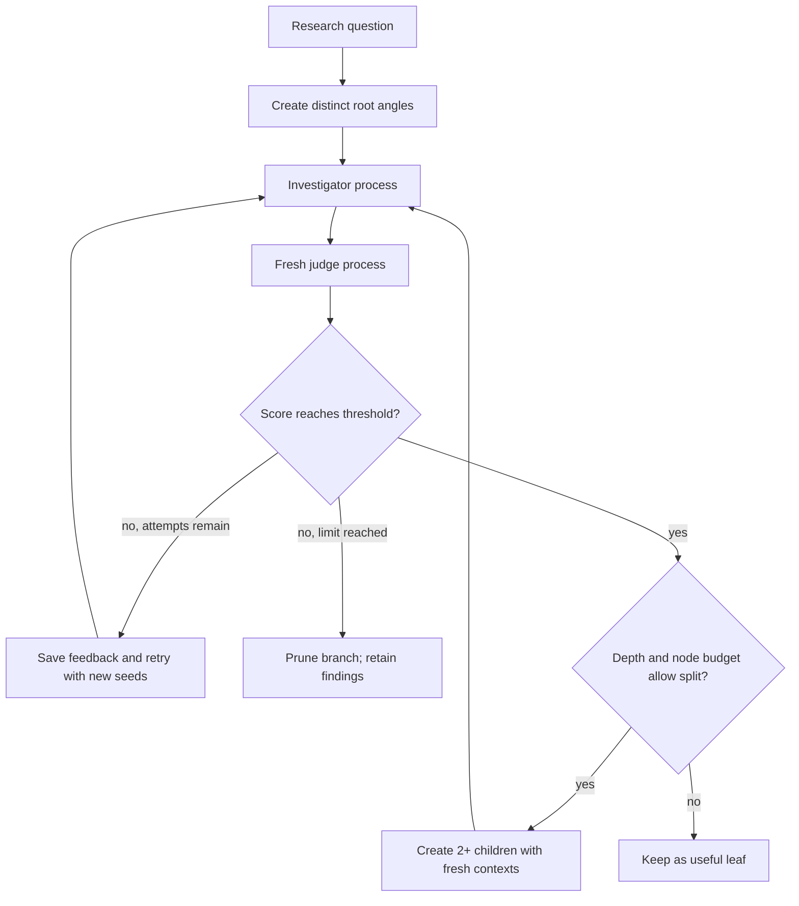

# Architecture

## Run lifecycle

Each researcher and judge call is a separate local CLI process. The judge receives the research output and prior checkpoint feedback, but not the investigator's randomized association payload. It applies a numeric threshold derived from the configured strictness.

## Branch and run records

`run.json` is the authoritative resumable manifest. It stores the question, configured provider names, call count, tree configuration snapshot, branch statuses, checkpoint scores, retained summaries, and all structured findings.

Every attempt gets its own artifact directory. The exact prompts and raw provider responses are saved alongside parsed JSON where available. This makes rejected branches auditable and preserves useful findings even when their branch is pruned.

Writes to `run.json` use a temporary file and atomic replacement. Parallel branches reserve investigator/judge call pairs under a lock so the configured call ceiling is respected.

## Randomized context

The default association block contains randomly selected word pairs and short alphanumeric labels. Its target size is calculated from prompt character counts to approximate the configured fraction. Exact token counts vary by provider and tokenizer. A configured seed makes the payload repeatable for the same question, angle, depth, and attempt. The payload is explicitly labeled ideation-only and is excluded from judge evidence.

## Provider boundary

Provider adapters are local argument vectors, invoked without a shell. The configured provider owns model selection, network access, tool use, and authentication. The included Codex command uses ephemeral, read-only mode. A separate provider or model can be assigned to the judge in `[providers].judge`.
